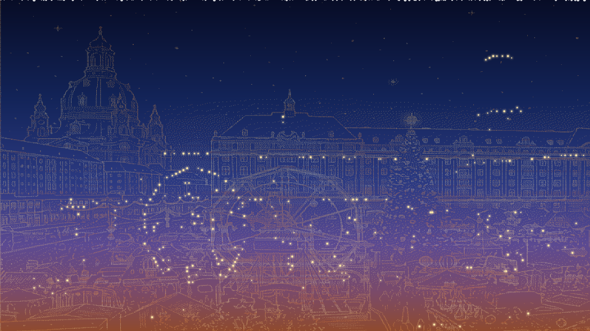
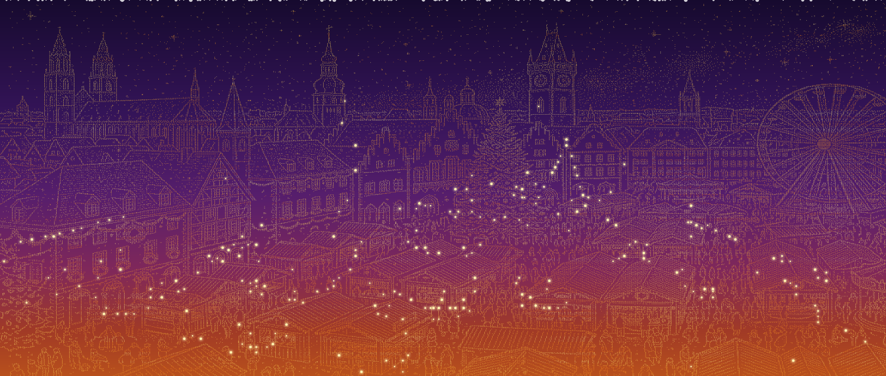
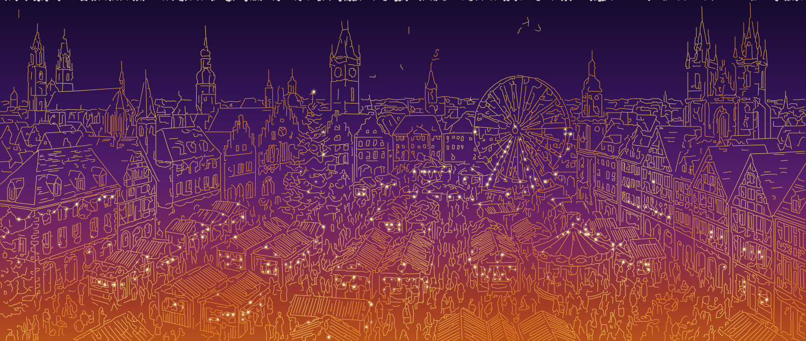

# Christmas Market Backdrop 🎄

A Claude Code mod that puts a twinkling Christmas market behind the conversation in the desktop app: a town square drawn in orange-to-yellow braille dots over a navy-to-sunset sky, with lights twinkling on the tree, the Ferris wheel and the garlands, falling snow, and a matching navy night palette.

A *backdrop* is a picture or animated scene a mod can draw behind the conversation in the Claude Code desktop and mobile apps. See [Put a backdrop behind the conversation](https://code.claude.com/docs/en/plugins/mods/interface#put-a-backdrop-behind-the-conversation) in the Claude Code docs.

<p align="center">
  
</p>

## Install

Requires the latest version of Claude Code (mods are only supported in recent versions; run `claude update` first if you're not sure).

At the prompt of a Claude Code terminal session:

```
/plugin install christmas-market --marketplace bakeyeon/christmas-market-backdrop
```

Answer `y` to add the marketplace, then press Enter to install for your user. New sessions in the desktop app show the backdrop.

From a shell:

```bash
claude plugin install christmas-market --marketplace bakeyeon/christmas-market-backdrop
```

In the desktop app: click **+** next to the prompt box → **Plugins** → **Add marketplace** with `bakeyeon/christmas-market-backdrop` → **Add plugin**.

> The backdrop draws in the desktop and mobile apps; a plain terminal shows no backdrop. The app pauses backdrop animation after a while, so the lights and snow move when a session opens and then rest as a still picture.

## What's inside

| Path | What it is |
| --- | --- |
| `hooks/` | The mod: sets the backdrop and palette (`register.tsx`), the scene (`scene.js`) |
| `svg/christmas-market-dots-sunset.svg` | The backdrop the mod shows, as a standalone animated SVG: orange-to-yellow dots over a navy-to-sunset sky (open it in a browser) |
| `svg/christmas-market-dots-navy.svg` | The earlier version: white dots over a navy-to-violet sky |
| `svg/christmas-market-lineart.svg` | A white line-art version of the same drawing |
| `svg/christmas-market-dots-orange-purple.svg` | Yellow-to-orange dots over an orange-to-purple sky, from a wider 21:9 drawing of the market |
| `svg/christmas-market-lineart-orange-purple.svg` | The same 21:9 drawing as yellow-to-orange line art over the orange-to-purple sky |
| `svg/convbyadobe.svg` | The full drawing traced to SVG with Adobe's online converter, for reference |
| `tools/to_dots.py` | Turns any picture into a braille-dot backdrop scene |
| `tools/to_lineart.py` | Turns any picture into a Canny line-art backdrop scene |
| `tools/to_dots_orange_purple.py` | Dot SVG in the orange-to-purple palette, keeping the picture's aspect; puts dots only along the drawn strokes instead of dithering (pass `dither` for the old look) |
| `tools/to_lineart_orange_purple.py` | Line-art SVG in the orange-to-purple palette; traces the centre of each stroke instead of Canny edges, which suits dense line drawings |

## Orange-to-purple versions

A wider (21:9) drawing of the market in yellow-to-orange over an orange-to-purple sky, as dots and as line art. Both are under the backdrop size limit.

<p align="center">
  
</p>
<p align="center">
  
</p>

```bash
python tools/to_dots_orange_purple.py picture.jpg dots.svg
python tools/to_lineart_orange_purple.py picture.jpg lineart.svg
```

## Make your own backdrop

Backdrop scenes must stay under 131,072 characters and can't embed images, so the tools redraw a picture as text dots or simplified lines. (`svg/convbyadobe.svg`, traced with Adobe's converter, is about 8 million characters, too large to use as a backdrop directly; the dot version was made from it.)

```bash
pip install pillow
python tools/to_dots.py picture.png hooks/scene.js preview.svg
```

```bash
pip install opencv-python numpy
python tools/to_lineart.py picture.png hooks/scene.js preview.svg
```

Both write `scene.js` (what the mod shows) and an SVG to preview in a browser. To start from an SVG, render it to PNG first, for example with headless Chrome:

```bash
chrome --headless=new --hide-scrollbars --window-size=2400,1792 --screenshot=picture.png file:///path/to/drawing.svg
```

The market drawing was generated with Gemini and converted with these tools.

## Image prompt

The prompt used to generate the market drawing, if you want to make your own variation:

```text
A panoramic, wide-angle cinematic view of a bustling European Christmas market at night, fully rendered in intricate, detailed white line art on a dark navy and deep violet background. A high-angle, birds-eye perspective looking down upon a vast festive square packed with hundreds of crowded wooden market stalls with decorated roofs, a majestic heavily decorated towering Christmas tree, and a giant glowing Ferris wheel.

The square is enclosed by a sprawling array of magnificent historical European architecture, grand cathedral-like churches, ornate clock towers, and half-timbered buildings, all densely packed together. Innumerable festive details fill the scene: endless cascading strings of fairy lights, garlands, wreaths on facades, and tiny merchandise in shop windows.

Dense crowds of tiny people gather in the plazas, walkways, and seating areas. The deep night sky is heavily speckled with countless twinkling stars, faint cosmic dust, and a gentle dusting of falling snow. Every single element, from the distant spires to the bustling crowds and ornaments, is entirely and meticulously drawn with fine, sparkling white lines, capturing a dense, magical, and festive holiday atmosphere. --ar 21:9
```

## License

MIT, see [LICENSE](LICENSE).
